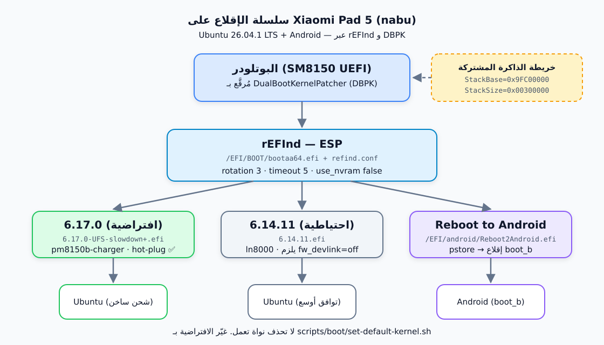

# Ubuntu على Xiaomi Pad 5 (nabu) — دليل عربي كامل ومُختبَر

> **تثبيت أوبونتو 26.04 على تابلت Xiaomi Pad 5 (الاسم الرمزي: nabu)، مع الإقلاع المزدوج مع أندرويد،
> وتشخيص وحلّ مشكلات الشحن واللمس والصوت والإقلاع — كل ما جُرِّب فعلياً على جهاز حقيقي موثَّق هنا.**

<p align="center">
  
  
  
  
  
</p>

---

## ما هذا المشروع؟

هذا المستودع يجمع **كل رحلة تثبيت أوبونتو على تابلت Xiaomi Pad 5** في مكان واحد:

1. **دليل تثبيت مفصّل** خطوة بخطوة (من فتح البوتلودر حتى أول إقلاع).
2. **إعداد ما بعد التثبيت**: التحديثات، العربية والخطوط، أدوات تثبيت البرامج، كروم على Wayland.
3. **الإقلاع المزدوج مع أندرويد** عبر rEFInd + DBPK Bootmanager، مع استعادة أندرويد عند الحاجة.
4. **تشخيص وحلّ مشكلات الشحن** (تحليل عميق لعطل `typec` و`ln8000`) + مسجّل تشخيص دائم.
5. **سكربتات جاهزة** للفحص والإصلاح، مكتوبة لتُشغَّل بأمان على الجهاز نفسه.
6. **جدول أعطال شائع** مع حلول مُختبَرة (شاشة سوداء، تعليق الشحن، اختفاء الشبكة…).

كل أمر في هذا المستودع نُفِّذ فعلياً على جهاز حقيقي، والنتائج موثّقة بأرقامها (انظر [docs/06-charging.md](docs/06-charging.md)).



---

## الحالة النهائية للجهاز (نتائج مُقاسة)

| المكوّن | الحالة | ملاحظات |
|---|---|---|
| الإقلاع (Ubuntu 26.04.1 LTS) | ✅ يعمل | rEFInd مع قائمة نواة + مدخل أندرويد |
| الشاشة واللمس (NVT) | ✅ يعمل | يشمل القلم `NVTCapacitivePen` |
| لوحة مفاتيح/فأرة Xiaomi Pad | ✅ تعمل | تُكتشف كأجهزة إدخال قياسية |
| الواي فاي (ath10k) | ✅ يعمل | 5GHz، عرض 80MHz |
| الصوت (WCD934x + CS35L41) | ✅ يعمل | مكبّر + سماعة + ميكروفون |
| السكون (s2idle) | ✅ متاح | قد تحتاج ضغطة زر إضافية للإيقاظ |
| سرعة التخزين UFS | ✅ سليمة | كتابة 1.7GB/s، قراءة 4.8GB/s |
| الشحن (نواة 6.17) | ✅ يعمل عند التوصيل الساخن | مُقيَّد بـ ~6W (1.2–1.25A) |
| الشحن (نواة 6.14.11) | ⚠️ يعمل فقط إذا وُصل الشاحن **قبل** الإقلاع | عطل معروف في `ln8000` |
| الإقلاع المزدوج مع أندرويد | ✅ يعمل | عبر مدخل «Reboot to Android» في rEFInd |

---

## الفهرس

| # | المستند | المحتوى |
|---|---|---|
| 00 | [نظرة عامة وقرارات](docs/00-overview.md) | خريطة الطريق، لماذا كل قرار، رسم العلاقات |
| 01 | [المتطلبات](docs/01-prerequisites.md) | العتاد، الملفات، فتح البوتلودر، النسخ الاحتياطي |
| 02 | [التثبيت](docs/02-install.md) | تقسيم القرص، كتابة النظام، تصحيح الإقلاع |
| 03 | [ما بعد التثبيت](docs/03-post-install.md) | التحديثات، العربية، البرامج، بيانات المستخدم |
| 04 | [الإقلاع المزدوج مع أندرويد](docs/04-dualboot.md) | rEFInd، DBPK، `Reboot2Android.efi`، استعادة `boot_b` |
| 05 | [النواة: 6.14 مقابل 6.17](docs/05-kernels.md) | الفروق، المخاطر، تغيير الافتراضي بأمان |
| 06 | [مشكلة الشحن — التشخيص الكامل](docs/06-charging.md) | `typec`، `-EPROBE_DEFER`، `ln8000`، القياسات، الحلول |
| 07 | [الأعطال الشائعة](docs/07-troubleshooting.md) | شاشة سوداء، gdm3، شبكة، صوت، سكون… |
| 08 | [التحكّم عن بُعد (SSH)](docs/08-remote-access.md) | مفاتيح، mDNS، أوامر جاهزة |
| 09 | [تطبيقات arm64 و Flatpak](docs/09-apps.md) | ما يعمل، ما لا يعمل، نقل الحزم يدوياً |
| 10 | [ورقة أوامر مرجعية](docs/10-cheatsheet.md) | كل الأوامر المهمة في صفحة واحدة |
| 11 | [روابط التحميل الكاملة](docs/11-downloads.md) | صورة النظام، TWRP، مدير الإقلاع، النوى، صورة أندرويد، بصمات SHA-256 |

---

## روابط التحميل (مختصر)

| الملف | الحجم | الرابط |
|---|---|---|
| صورة Ubuntu 26.04 لنابو | 1.78 GB | [تحميل](https://github.com/TheMojoMan/xiaomi-nabu/releases/download/ubuntu-26.04-v1.0.0/ubuntu-26.04-xiaomi-nabu.img.xz) |
| TWRP المعدّل | 50 MB | [تحميل](https://github.com/TheMojoMan/xiaomi-nabu/releases/download/ubuntu-26.04-v1.0.0/V4-MODDED-TWRP-LINUX.img) |
| DBPK Bootmanager | 4.9 MB | [تحميل](https://github.com/TheMojoMan/xiaomi-nabu/releases/download/ubuntu-26.04-v1.0.0/installer_bootmanager_NOSB.zip) |
| حزمة ESP (`efi.tar`) | 70 MB | [تحميل](https://github.com/TheMojoMan/xiaomi-nabu/releases/download/ubuntu-26.04-v1.0.0/efi.tar) |
| نواة 6.17.0 (الافتراضية) | 36 MB | [تحميل](https://github.com/zulf96/nabu-ubuntu/releases/download/nabu-kernels/6.17.0-UFS-slowdown+.efi) |
| نواة 6.14.11 (احتياطية) | 31 MB | [تحميل](https://github.com/zulf96/nabu-ubuntu/releases/download/nabu-kernels/6.14.11.efi) |
| إقلاع أندرويد HyperOS 1.0.1 + Magisk v27 | 128 MB | [تحميل](https://github.com/zulf96/nabu-ubuntu/releases/download/nabu-android-boot/Boot_HyperOS1.0.1_GlobalOriginal_PatchmagiskV27_by-Artoseven.img) |

> التفاصيل والبصمات وطريقة التحقق: [docs/11-downloads.md](docs/11-downloads.md).

---

## البدء السريع

```bash
git clone https://github.com/<USER>/nabu-ubuntu.git
cd nabu-ubuntu

# 1) فحص صحة الجهاز (بعد التثبيت) — للقراءة فقط، لا يغيّر شيئاً
sudo bash scripts/diagnostics/health-check.sh

# 2) في حال تعطّل الشحن: تحقّق أين تتوقف السلسلة
sudo bash scripts/diagnostics/health-check.sh --charging

# 3) إعداد العربية والخطوط (يبقي واجهة النظام إنجليزية)
sudo bash scripts/post-install/setup-arabic.sh

# 4) تثبيت مسجّل تشخيص الشحن (سطر كل دقيقة)
sudo bash scripts/post-install/install-charge-log.sh
```

> التثبيت نفسه يبدأ من [docs/02-install.md](docs/02-install.md) — **اقرأ المستند كاملاً قبل البدء**.

---

## شجرة المستودع

```
nabu-ubuntu/
├── README.md                     ← أنت هنا
├── README.en.md                  ← English summary
├── CONTRIBUTING.md               ← قواعد المساهمة والاختبار
├── CHANGELOG.md                  ← سجل التغييرات والقرارات
├── LICENSE                       ← MIT
├── Makefile                      ← make check / make test
├── docs/                         ← 12 مستنداً عربياً مفصّلاً
├── scripts/
│   ├── lib/common.sh             ← دوال مشتركة (root، mount ESP، كشف الجهاز)
│   ├── post-install/
│   │   ├── setup-arabic.sh       ← لغة/خطوط/لوحة مفاتيح عربية
│   │   ├── setup-deb-gui.sh      ← GDebi + GNOME Software + Flatpak
│   │   ├── setup-chrome-wayland.sh ← كروم على Wayland مع IME
│   │   └── install-charge-log.sh ← خدمة تسجيل حالة الشحن كل دقيقة
│   ├── diagnostics/
│   │   ├── health-check.sh       ← فحص شامل (نواة/شحن/شبكة/صوت/حرارة)
│   │   ├── charge-report.sh      ← تحليل منحنى الشحن من السجل
│   │   └── typec-watchdog.sh     ← فحص typec (قراءة فقط، بلا unbind)
│   └── boot/
│       ├── set-default-kernel.sh ← تغيير نواة rEFInd الافتراضية بأمان
│       ├── patch-kernel-cmdline.sh ← تعديل cmdline داخل EFI stub بأمان
│       ├── install-android-entry.sh ← إضافة مدخل أندرويد إلى rEFInd
│       └── Reboot2Android.efi    ← أداة الإقلاع إلى أندرويد
├── assets/
│   └── boot-flow.svg             ← مخطط سلسلة الإقلاع
├── tools/check-links.py          ← فحص الروابط والمراسي في Markdown
├── tests/fixtures/               ← سجل شحن تجريبي لاختبار charge-report
└── .github/workflows/ci.yml      ← فحص تلقائي للصياغة والروابط
```

---

## التطوير والاختبار

```bash
make check     # bash -n لكل السكربتات + فحص الروابط والمراسي
make test      # كل ما سبق + تحليل سجل شحن تجريبي
```

الفحص نفسه يعمل تلقائياً على GitHub Actions عند كل push أو Pull Request.

---

## النشر على GitHub

المستودع مُهيَّأ محلياً (`.git` + أول commit جاهز). للرفع:

```bash
cd nabu-ubuntu

# الطريقة 1: مستودع موجود مسبقاً على GitHub
git remote add origin https://github.com/<USER>/nabu-ubuntu.git
git push -u origin main

# الطريقة 2: إنشاء المستودع ورفعه بأمر واحد (يتطلب gh)
gh repo create nabu-ubuntu --public --source=. --push
```

> غيّر `<USER>` باسم حسابك. بعد الرفع سيعمل فحص CI تلقائياً على GitHub Actions.

---

## تحذير وإخلاء مسؤولية

- **هذا ليس مشروعاً رسمياً** لأوبونتو أو شاومي أو أي شركة.
- التثبيت **يمسح بيانات أندرويد** (أو يحتاج إعادة تقسيم). **خُذ نسخة احتياطية كاملة أولاً.**
- فتح البوتلودر يُلغي الضمان ويُصفّر الجهاز.
- أنت من يتحمّل المخاطر. راجع [docs/01-prerequisites.md](docs/01-prerequisites.md).
- **لا تنفّذ** `unbind` لمُقرِّر `ln8000` يدوياً — يُسقط النواة (موثّق في [docs/06-charging.md](docs/06-charging.md#تحذير-انهيار-النواة)).

---

## الشكر والمصادر

هذا العمل يقف على أكتاف مجتمع nabu:

- **[TheMojoMan](https://github.com/TheMojoMan/xiaomi-nabu)** — صور أوبونتو، النواة، مستودع الحزم (PPA).
- **[rodriguezst](https://github.com/rodriguezst/nabu-dualboot-img)** — DBPK / Bootmanager للإقلاع المزدوج.
- **[ArKT-7](https://github.com/ArKT-7/twrp_device_xiaomi_nabu)** — TWRP معدّل لقرص لينكس.
- **[Timofey (timoxa0)](https://github.com/timoxa0)** — ملفات EFI للإقلاع.
- **[map220v](https://github.com/map220v/sm8150-mainline)** — نواة SM8150 الرئيسية.
- مجتمع **[t.me/nabulinux](https://t.me/nabulinux)**.

---

## الترخيص

[MIT](LICENSE) — استخدمه وطوّره بحرية مع ذكر المصدر.
