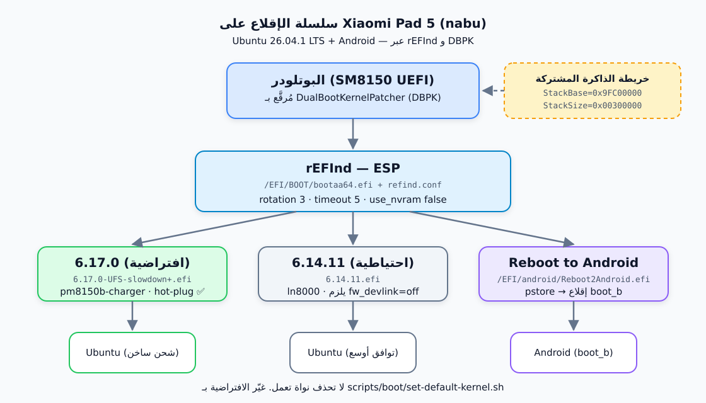
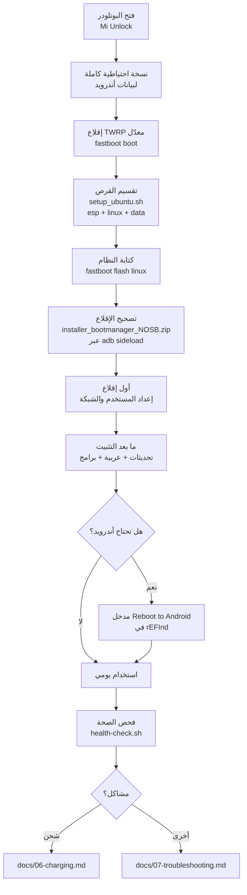

# 00 — نظرة عامة وخريطة الطريق

## 1. الجهاز

| | |
|---|---|
| الاسم التجاري | Xiaomi Pad 5 |
| الاسم الرمزي | **nabu** |
| المعالج | Qualcomm Snapdragon 860 (SM8150) — arm64 |
| الشاشة | 11" 2560×1600 (تحتاج `rotation 3` في rEFInd) |
| التخزين | UFS 3.1 |
| البوتلودر | يجب فتحه (Mi Unlock) |
| التوزيعة المثبَّتة | Ubuntu 26.04.1 LTS (resolute) — arm64 |

> الجهاز **ليس** x86. كل حزمة تُثبَّت يجب أن تكون `arm64`. أي برنامج ويندوز
> (`WoeUSB`، برامج `.exe`) لن يعمل إلا عبر محاكاة، وكثير منها غير متاح.

## 2. خريطة الطريق





## 3. القرارات المعمارية (ولماذا)

| القرار | البديل | السبب |
|---|---|---|
| تقسيم **esp + linux + data** | esp + linux فقط | يسمح بإعادة تثبيت لينكس دون فقدان `/media/data`. |
| **الإقلاع المزدوج** (إبقاء أندرويد) | مسح أندرويد كلياً | المستخدم يحتاج أندرويد للتطبيقات الأصلية والشحن السريع. |
| **rEFInd** كمدير إقلاع | systemd-boot | rEFInd يُقلع ملفات `.efi` مباشرة ويدعم نواة متعددة + مدخل أندرويد، ويحترم `rotation`. |
| **`6.17.0`** كنواة افتراضية | `6.14.11` | التوصيل الساخن للشاحن يعمل فيها (`pm8150b-charger`). |
| إبقاء **`6.14.11`** في القائمة | حذفها | احتياط: تُقلع على كل الأجهزة (حتى Samsung UFS). |
| **واجهة إنجليزية + عربية للكتابة** | واجهة عربية كاملة | طلب المستخدم؛ تجنّب مشاكل اتجاه الواجهات. |
| **`fw_devlink=off`** في `6.14.11` | `permissive` | حلّ تعثّر `typec` (3/3 نجاح مقابل 2/5). |
| تعطيل **`typec-watchdog`** | إبقاؤها | `unbind/bind` لا يعمل (`EAGAIN`) وقد يكون خطراً. |
| **مسجّل شحن** كل دقيقة | فحص يدوي | يلتقط منحنى الشحن أياً كان وقت التوصيل. |

## 4. خريطة التخزين الناتجة

```
/dev/sda
├── sda1 … sda30   أقسام أندرويد (boot_a/boot_b، vendor، system، userdata…)
├── sda31          ESP   (FAT32) → /mnt/esp
│                      ├── EFI/BOOT/       rEFInd (bootaa64.efi + refind.conf)
│                      ├── EFI/Ubuntu/     6.14.11.efi، 6.17.0.efi، 7.3.5.efi
│                      └── EFI/android/    Reboot2Android.efi
├── sdaXX          linux (ext4)  → /          (PARTLABEL=linux)
└── sdaYY          data  (ext4)  → /media/data (اختياري، من fstab)
```

> أرقام الأقسام تختلف بين الأجهزة. اكتشفها بـ `lsblk -o NAME,PARTLABEL,SIZE,MOUNTPOINT`
> أو `sudo blkid | grep -E 'esp|linux|data'`.

## 5. أين تبدأ؟

- إن كنت **لم تثبّت بعد**: [01-prerequisites.md](01-prerequisites.md) ← [02-install.md](02-install.md).
- إن ثبّتت وتريد التهيئة: [03-post-install.md](03-post-install.md).
- إن عندك مشكلة الآن: [07-troubleshooting.md](07-troubleshooting.md)،
  وللشحن تحديداً: [06-charging.md](06-charging.md).
