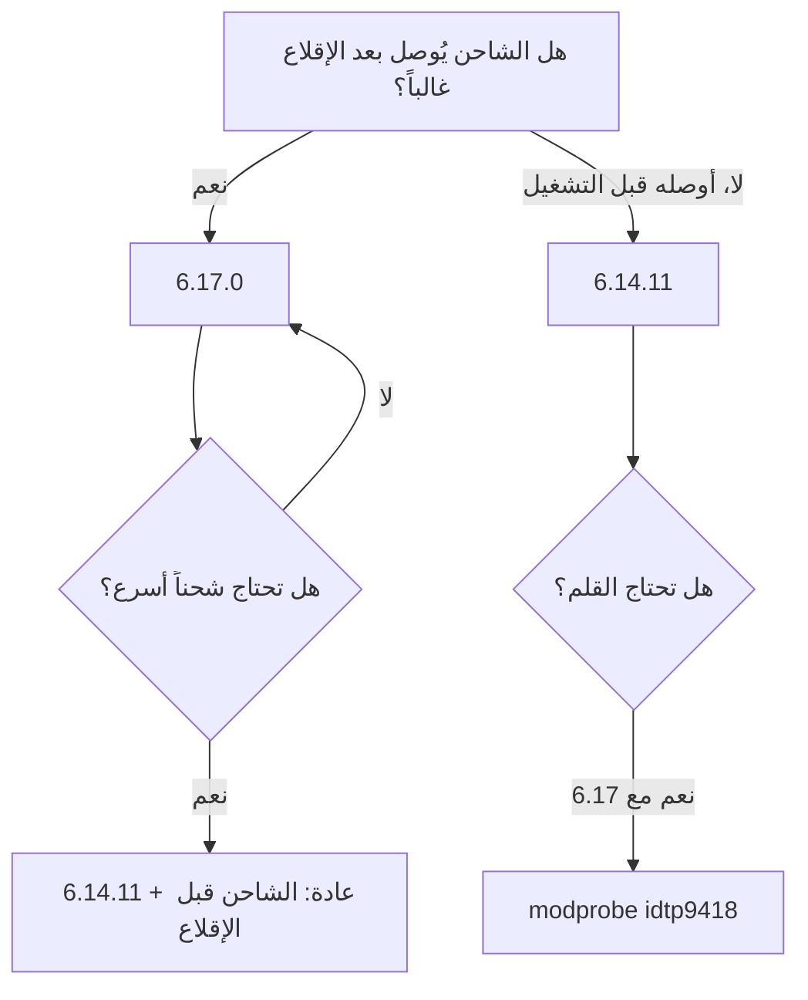

# 05 — النواة: `6.14.11` مقابل `6.17.0`

جهازنا عليه نواتان من مستودع TheMojoMan، وكل منهما لها نقاط قوة وضعف **متضاربة**.
هذا المستند يشرح الفرق ويوضّح كيف تختار بأمان.

## 1. جدول المقارنة

| | **6.14.11-nabu-tmm+** | **6.17.0-xiaomi-nabu-tmm-UFS-slowdown+** |
|---|---|---|
| الحزمة | `xiaomi-nabu-linux-6.14` | `xiaomi-nabu-linux-6.17` |
| مُقرِّر الشحن | `ln8000_charger` (شريحة خارجية) | `pm8150b-charger` (SMB5 داخل PMIC) |
| الشحن السريع | ✅ أعلى (حتى 3A دخل) | ⚠️ مُقيَّد ~1.2–1.25A (~6W) |
| **التوصيل الساخن** (شاحن بعد الإقلاع) | ❌ **معطوب** (حلقة إعادة محاولة) | ✅ **يعمل خلال ثوانٍ** |
| `typec` | يحتاج `fw_devlink=off` | سليم أصلاً |
| قلم شاومي | ✅ مباشرة | ⚠️ يحتاج `modprobe idtp9418` |
| إقلاع على أقراص Samsung UFS | ✅ كل الأجهزة | ⚠️ قد يفشل (شاشة سوداء) |
| سرعة UFS (مقاسة عندنا) | — | ✅ ك1.7GB/s، ق4.8GB/s |
| استقرار عام | ✅ جيد | ✅ جيد (0 خدمات فاشلة) |

## 2. لماذا هذا الاختلاف؟

- **6.14.11** تستخدم مسار الشحن المتوازي: الشريحة `ln8000` (buck charger خارجي)
  مع SMB5. مسار التوصيل الساخن في مُقرِّر `ln8000` **لا يُعيد تهيئة الشريحة**.
- **6.17.0** تعتمد على SMB5 وحدها (`pm8150b-charger`)، والمُقرِّر القياسي
  في نواة لينكس يتعامل مع التوصيل الساخن بشكل صحيح.

التفاصيل الكاملة للقياسات: [06-charging.md](06-charging.md).

## 3. أي نواة تختار؟



**التوصية العملية:** ابدأ بـ `6.17.0` (الأكثر راحة)، واحتفظ بـ `6.14.11` كخيار
في القائمة عندما تحتاج شحناً أسرع وتعرف أنك ستُوصِل الشاحن قبل الإقلاع.

> إن كان جهازك لا يُقلع 6.17 (شاشة سوداء): اجعل `6.14.11` الافتراضية فوراً.

## 4. تغيير الافتراضية

```bash
sudo bash scripts/boot/set-default-kernel.sh 6.14.11
sudo reboot
```

## 5. تعديل سطر أوامر النواة (متقدّم)

سطر الأوامر **مضمَّن داخل ملف `.efi`** وليس في `refind.conf`، لذلك لا يكفي تعديل
`refind.conf`. السكربت يتعامل مع البنية بأمان:

```bash
# عرض سطر الأوامر الحالي داخل الملف
sudo bash scripts/boot/patch-kernel-cmdline.sh --show

# تغيير قيمة (يحفظ الطول ويأخذ نسخة احتياطية)
sudo bash scripts/boot/patch-kernel-cmdline.sh --set fw_devlink=off

# العودة للنسخة الأصلية
sudo bash scripts/boot/patch-kernel-cmdline.sh --revert
```

### تفاصيل تقنية (لماذا الطول مهم)

```
الموقع:   offset 108544 داخل 6.14.11.efi
المحتوى:  root=PARTLABEL=linux rw fw_devlink=permissive\0   (45 بايت)
بعد الترقيع: root=PARTLABEL=linux rw fw_devlink=off     \0   (45 بايت، مسافات للتعويض)
```

- أي تغيير في الطول قد يُفسد بنية EFI stub (لأن الحقول المجاورة تعتمد على الإزاحة).
- لذلك السكربت: يقرأ النص، **يجبر نفس الطول** (يملأ بمسافات)، ويكتب NUL، ويأخذ نسخة.
- تحقّق بعد الإقلاع: `cat /proc/cmdline`.

### القيم الموصى بها

| القيمة | الأثر | متى |
|---|---|---|
| `fw_devlink=permissive` | الافتراضي الأصلي | — |
| `fw_devlink=off` | يمنع `-EPROBE_DEFER` لـ `typec` | **6.14.11 فقط** |
| `fw_devlink=on` | أقوى ترتيب اعتماديات | لا تستخدمه هنا |

> `6.17.0` **لا يحتاج** أي ترقيع — لا تعبث بملفه.

## 6. ملفات النواة على الجهاز

```bash
# صور الإقلاع
ls -lh /mnt/esp/EFI/Ubuntu/

# الوحدات
ls /lib/modules/

# مُقرِّرات الشحن
modinfo ln8000_charger 2>/dev/null | head -3
modinfo pm8150b_charger 2>/dev/null | head -3

# التحقق من الوحدة المستخدمة فعلياً
ls /sys/class/power_supply/
```

## 7. تحذير: بناء وحدة بنفسك

مجلد `/lib/modules/<ver>/build` غير موجود (رابط مكسور إلى مسار بناء المطوّر)،
ولا توجد حزمة `linux-source` مطابقة في المستودع. أي محاولة `dkms`/`make -C`
ستفشل. استخدم نواة جاهزة من المستودع بدلاً من البناء.

→ التالي: [06-charging.md](06-charging.md) — التحليل الكامل لمشكلة الشحن.
