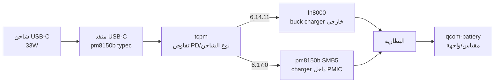

# 06 — مشكلة الشحن: التشخيص الكامل والحل

> هذا المستند يوثّق تحقيقاً كاملاً استمر ساعات على جهاز حقيقي، مع كل قياس،
> وكل فرضية أُبعدت بالدليل، والحل النهائي.

## TL;DR

| السؤال | الجواب |
|---|---|
| هل المشكلة عتاد؟ | **لا.** الشحن يعمل قبل الإقلاع وفي أندرويد، بشاحنين وكابلين مختلفين. |
| ما السبب؟ | **برمجي، في مُقرِّر الشحن.** على `6.14.11` مُقرِّر `ln8000` لا يهيّئ الشريحة عند التوصيل الساخن. |
| هل `typec` هو المشكلة؟ | كان جزءاً منها؛ حُلّ بـ `fw_devlink=off`. لكن `typec` تُربَط الآن دائماً. |
| الحل العملي؟ | **استخدم نواة `6.17.0`** — التوصيل الساخن يعمل خلال ثوانٍ. |
| ما الثمن؟ | الشحن مُقيَّد بـ ~6W (1.2–1.25A) لأن الشريحة السريعة `ln8000` غير مُدارة في 6.17. |
| هل أُصلح `ln8000`؟ | لا. إعادة ربطه يدوياً **تُسقط النواة**. الإصلاح الحقيقي يحتاج بناء المُقرِّر من المصدر. |

---

## 1. الأعراض

- البطارية عالقة عند نسبة معيّنة مع `Discharging` رغم توصيل الشاحن.
- الشحن «يعمل أحياناً» — متغيّر بين الإقلاعات.
- عند توصيل الشاحن **بعد** الإقلاع: لا شيء يحدث (أو تيار ±40mA فقط).
- عند توصيل الشاحن **قبل** الإقلاع: يعمل.

## 2. مسار الشحن في nabu



- `typec` (pm8150b) يكتشف الشاحن ويحدّد النوع (SDP/DCP/CDP) والجهد.
- ثم يُبلّغ `tcpm` مُقرِّر الشحن المناسب.
- مُقرِّر الشحن يضبط تيار/جهد الشحن على الشريحة.

**أي حلقة تنكسر ⇒ لا شحن.** ولذلك كان التشخيص طبقة بطبقة.

---

## 3. المشكلة الأولى: `typec` يتعثّر بصمت (`-EPROBE_DEFER`)

### الأعراض

```bash
ls /sys/class/typec/                    # فارغ!
sudo cat /sys/kernel/debug/devices_deferred
# c440000.spmi:pmic@2:typec@1500	          ← السبب فارغ
```

محاولة ربط يدوي:

```bash
echo c440000.spmi:pmic@2:typec@1500 \
  | sudo tee /sys/bus/platform/drivers/qcom,pmic-typec/bind
# Write error: Resource temporarily unavailable  (errno=11 / EAGAIN)
```

### ما أُبعد بالدليل

| الفرضية | كيف أُبعدت |
|---|---|
| منظّم `vdd-vbus`/`vdd-pdphy` مفقود | موجودان و`of_node` مطابق، `available` |
| مشكلة IRQ | نفس سلسلة `interrupt-parent` تعمل لـ `temp-alarm` و`adc` و`pon` |
| pinctrl / dma / power-domain | كلها مربوطة وسليمة |
| عتاد المنفذ | الشحن يعمل قبل الإقلاع وفي أندرويد |
| الشاحن/الكابل | جُرِّب شاحنان أصليان وكابلان |

### الحل: `fw_devlink=off`

سطر أوامر النواة كان `... fw_devlink=permissive`، و`fw_devlink` يمنع إعادة محاولة
الربط بعد `-EPROBE_DEFER` الصامت.

```bash
sudo bash scripts/boot/patch-kernel-cmdline.sh --set fw_devlink=off
sudo reboot
cat /proc/cmdline     # يجب أن يظهر fw_devlink=off
```

### النتيجة

| قبل الترقيع | بعد الترقيع |
|---|---|
| `typec` مربوطة في **2 من 5** إقلاعات | **3 من 3** إقلاعات ✅ |

> بعد الترقيع: `typec` مربوطة دائماً و`/sys/class/typec/` يحتوي `port0`.
> **لكن** مشكلة الشحن لم تُحلّ كاملة — ظهر أن هناك طبقة أعمق.

---

## 4. المشكلة الحقيقية: `ln8000` لا يعالج التوصيل الساخن

### التجربة الحاسمة

نفس النواة (`6.14.11`)، نفس الشاحن، **الفرق الوحيد: توقيت التوصيل**.

| المؤشر | موصول **قبل** الإقلاع ✅ | موصول **بعد** الإقلاع ❌ |
|---|---|---|
| `typec` | BOUND ✓ | BOUND ✓ |
| `port0-partner` | موجود | يظهر متأخراً |
| `psy_chg_set_charging_enable` | **0 مرة** | **كل ثانية** (حلقة) |
| `ln8000_change_opmode` | `[0]→[1]` مرة | `[1]→[3]→[1]` متكرر |
| `ln8000_update_opmode` | — | `op_mode [3]->[1] (sys_st=0x2)` |
| `interrupt_handler` بعد الإقلاع | — | **لا شيء** |
| سجل `0x0A` / `0x0B` | `0xd0` / `0x94` | **`0xd4` / `0xa4`** |
| `input_current_limit` | 3 050 000 | 3 050 000 |
| ADC عند التوصيل | `adc_vin=5024` (VBUS 5.02V) | `adc_vin=5024` |
| تيار الشحن | **-390mA** | -30..-70mA متذبذب |

### التفسير

```
[ 113.99] psy_chg_set_charging_enable: start charging    ← يطلب التشغيل
[ 114.00] ln8000_change_opmode: [1] -> [3]               ← يذهب لوضع standby
[ 114.01] update_opmode: [3] -> [1] (sys_st=0x2)         ← يرجع فوراً
[ 115.05] psy_chg_set_charging_enable: start charging    ← ويعيد كل ثانية…
```

الشريحة **تستقبل** أوامر التشغيل كل ثانية لكنها تبقى في `standby`، ولا يصل
`interrupt` من الشريحة بعد التوصيل — أي أن مسار التهيئة عند الحدث (hot-plug)
معطوب، بينما مسار التهيئة عند الإقلاع يعمل.

### تحذير: انهيار النواة

محاولة إعادة ربط المُقرِّر يدوياً:

```bash
# لا تفعل هذا! 🔴
echo 1-0051 | sudo tee /sys/bus/i2c/drivers/ln8000_charger/unbind
```

النتيجة:

```
Unable to handle kernel NULL pointer dereference at 0000000000000008
Internal error: Oops: 96000004 [#1] PREEMPT SMP
...
Unable to handle kernel NULL pointer dereference at 0000000000000030
Internal error: Oops: 96000004 [#2] PREEMPT SMP
```

- الانهيار في مسار `remove` الخاص بالمُقرِّر (مؤشر NULL).
- النظام تعافى بعد **إعادة تشغيل عادية** (0 أخطاء Oops بعد الإقلاع).
- **لا تُعِد المحاولة.** الحل ليس إعادة الربط.

---

## 5. الحل المعتمد: نواة `6.17.0`

على `6.17.0` يستخدم النظام `pm8150b-charger` (SMB5) مباشرة، والتوصيل الساخن
يعمل في المُقرِّر القياسي.

### نتيجة الاختبار (شاحن يُوصَل بعد الإقلاع)

```
20:21:22 | chg[Discharging]  | cap=99% | typec[port0]
20:21:51 | chg[Charging]     | cap=99%
20:21:58 | chg[Charging]     | typec[port0, port0-partner]   ← تعرّف الشاحن
          usb_type = DCP     ← الشاحن الأصلي معروف
          mode = 3.0A
```

- اكتشاف الشاحن: **أقل من 3 ثوانٍ**.
- `online=1`، `usb_type=DCP`، `port0-partner` موجود.
- تحت حمل 8 أنوية كامل لمدة 3 دقائق **لم تنقص النسبة** (99% ثابتة) ⇒ الشاحن
  يُغذّي الجهاز فعلاً بدل البطارية.

### السقف الحالي

```bash
cat /sys/class/power_supply/pm8150b-charger/current_max
# 1200000 … 1250000   (1.2–1.25A ≈ 6–6.5W؛ يتغيّر بين الإقلاعات)
```

- الكتابة (`echo 3000000 > current_max`) تُقبل لكن المُقرِّر يُعيد القيمة السابقة فوراً.
- **لا يوجد** مفتاح sysfs/debugfs لرفع الحد في هذه النواة.
- النتيجة: شحن أبطأ من أندرويد (33W) لكنه **مستقر ولا يحتاج شروطاً**.

> **عند الامتلاء** (`99%+, 4.41V`) يتوقف التيار (~2–4mA) وهذا **طبيعي**، ليس عطلاً.
> مؤشر آخر: `pm8150b-charger/status = Full`.

---

## 6. ملاحظات تجميلية (ليست أعطالاً)

| القراءة | التفسير |
|---|---|
| `ln8000-charger/present = 0` | قراءة غير موثوقة — اعتمد على `qcom-battery/status` |
| `usb_vbus = disabled` | طبيعي في وضع sink (الجهاز يستقبل الطاقة) |
| `upower` يقول `discharging` | عدم تناسق في حساب المعدّل عند الامتلاء على 6.17 |
| تيار ينخفض إلى 250–500mA فوق 97% | مرحلة السعة الثابتة (CV) — طبيعي |
| `pm8150b-charger/voltage_now = 0` | المُقرِّر لا يُبلّغ جهد الدخل على هذه المنصة |

---

## 7. أدوات التشخيص الجاهزة

### فحص لحظي كامل

```bash
sudo bash scripts/diagnostics/health-check.sh --charging
```

يطبع: `typec` (BOUND/UNBOUND)، `port0`، `devices_deferred`، كل مصادر الطاقة،
`status`، `current_now`، `capacity`، وآخر رسائل `ln8000`.

### مسجّل دائم (سطر كل دقيقة)

```bash
sudo bash scripts/post-install/install-charge-log.sh
```

- يكتب إلى `/var/log/nabu-charge.csv`:
  `ts,cap,status,ibat_ma,vbat_mv,chg_name,chg_status,chg_online,chg_type,typec_partner`
- يعمل تلقائياً بعد كل إقلاع.
- صُمِّم ليعمل على النواتين (يكتشف `pm8150b` أو `ln8000` تلقائياً).

### تحليل المنحنى

```bash
bash scripts/diagnostics/charge-report.sh
```

يحسب: مدة جلسات الشحن، نسبة البداية/النهاية، المعدّل **%/ساعة**، والتيار المتوسط.

---

## 8. مصفوفة الاسترداد (ماذا تفعل الآن؟)

| الموقف | الإجراء |
|---|---|
| على 6.14.11 والشحن لا يبدأ بعد التوصيل | **أعد التشغيل** — الربط عند الإقلاع يُصلح الحالة |
| تريد الشحن السريع اليوم | أطفئ، وصّل الشاحن، ثم شغّل (6.14.11) |
| تريد راحة دائمة | أقلع `6.17.0` واجعلها الافتراضية |
| `typec` غير مربوطة (`/sys/class/typec` فارغ) | تحقّق من `fw_devlink=off`، ثم أعد التشغيل |
| الشاحن لا يُكتشف أصلاً | جرّب كابلاً/منفذاً آخر، وتأكد من كهرباء المقبس |
| البطارية لا تتجاوز 99% | طبيعي عند الامتلاء |

---

## 9. مسارات لم تُجرَّب (فرص مستقبلية)

1. **بناء `ln8000_charger` بإصلاح hot-plug** — يحتاج مصدر النواة المطابق
   (`/lib/modules/.../build` رابط مكسور، ولا حزمة `linux-source`). غير متاح حالياً.
2. **إبلاغ upstream** بمسار `psy_chg_set_charging_enable` المتكرر — مفيد للمجتمع.
3. **رفع حد 1.2–1.25A** عبر تعديل شجرة الجهاز (DT) أو بناء نواة — يحتاج بناء.
4. **`6.14.11` + قاعدة udev** تُعيد تشغيل مسار التهيئة عند التوصيل — **خطر** لأن
   أي `unbind` لـ `ln8000` يُسقط النواة.

---

## 10. الخلاصة

- المشكلة **ليست** عتاداً ولا شاحناً ولا كابلاً.
- `typec` كان يعاني تعثّراً صامتاً، وحُلّ فعلياً بـ `fw_devlink=off` (3/3).
- الطبقة الأعمق: مُقرِّر `ln8000` لا يتعامل مع التوصيل الساخن.
- الحل المتاح **الآن** هو `6.17.0`: توصيل ساخن فوري، شحن مستقر، بحد ~6W.
- أي محاولة «إصلاح سريع» بإعادة ربط `ln8000` **تُسقط النواة** — لا تفعلها.

→ الأعطال الأخرى: [07-troubleshooting.md](07-troubleshooting.md).
